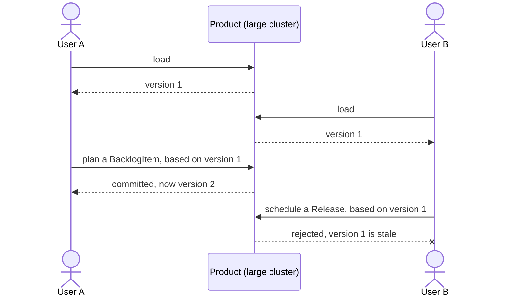
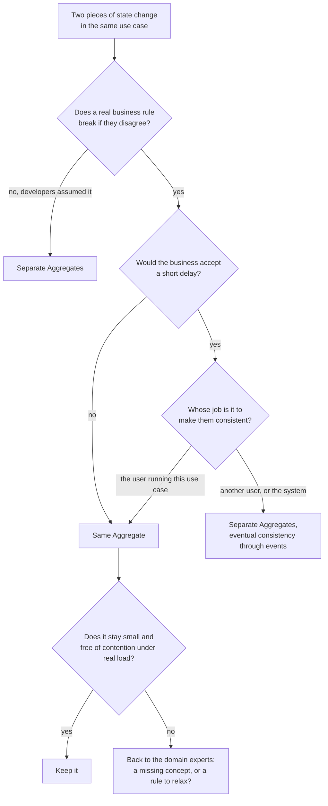
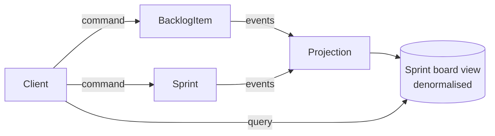

## Problem context

In a rich object model, references lead everywhere. From a customer you can walk to their orders, line items, products, inventory records and delivery logs. That is harmless with one user. With many users changing overlapping parts of the graph, two questions have no good answer: how much do you lock, and how much must you reload before you can trust a business rule?

Lock too little and rules break. Lock too much and users block each other for no reason. Evans describes the failure directly: cautious locking schemes "cause multiple users to interfere pointlessly with each other and can make a system unusable."

Aggregates answer both questions by putting the edges in the model itself.

## What an Aggregate is

An Aggregate is a cluster of associated domain objects, changed together as one unit, that exists to enforce **invariants**. An invariant is a business rule that must hold whenever a transaction commits:

- A purchase order's line items must not add up to more than its approved limit.
- A help desk ticket can't be closed while a critical safety task on it is still open.
- A backlog item's status moves to `DONE` when no hours remain on any of its tasks.

The Aggregate is the boundary around exactly the state one of these rules needs. Evans sums up the split:

> Within an aggregate boundary, apply consistency rules synchronously. Across boundaries, handle updates asynchronously.

The rest of this article uses Vernon's Scrum model as its running example.


| Part | Role | Identity |
| --- | --- | --- |
| **Aggregate Root** | The only entry point. Checks every invariant when a command runs. | Global |
| **Internal Entities** | Parts that change over time, with a lifecycle managed by the root. | Local to the Aggregate |
| **Value Objects** | Immutable descriptions, replaced whole rather than edited. | None |
| **Transaction scope** | Every change inside the boundary commits atomically. | n/a |

An Aggregate is a consistency boundary, not a way of grouping objects that seem related. As Vernon puts it, Aggregates are "chiefly about consistency boundaries and not driven by a desire to design object graphs." A tree of objects that looks tidy on a diagram but protects no rule isn't an Aggregate.

## Inside the boundary

### The root

Every Aggregate has exactly one root Entity, and Evans gives it strict rules:

- **Outside objects hold references to the root only.** The root may pass out a reference to an internal part, but for use within a single operation only.
- **The root enforces the invariants** of the Aggregate as a whole.
- **Only roots can be fetched directly from the database.** Everything else is reached by traversal from the root.
- **Delete removes everything inside the boundary at once.**
- **Every invariant holds at commit**, whichever part changed.

### Global and local identity

The root has an identity that is unique across the system, so it can be stored, looked up and referenced from anywhere. Entities inside the boundary only need to be unique within their Aggregate.

Evans illustrates this with a car. The car has a global identity, its VIN. Its tires are tracked, but only in the context of that car, so nobody queries for a tire on its own. An engine with a serial number may be tracked independently of any one car, and then it becomes the root of its own Aggregate.


The engine shows that **the boundary comes from the business, not from the physical parts**. A body shop and an engine remanufacturer can model the same car differently, and both can be right.

The same shape appears in every domain:

| Domain | Root, with global identity | Inside, with local identity | Outside, referenced by identity |
| --- | --- | --- | --- |
| Car (Evans) | `Car`, by VIN | Tires and wheels | `Engine`, when tracked on its own |
| Help desk (Khononov) | `Ticket` | `Message` | `Customer` |
| Scrum (Vernon) | `BacklogItem` | `Task` | `Product`, `Release`, `Sprint` |

### Prefer Value Objects

Treating every part as an Entity is a common modelling mistake. Vernon's test: does this part have to change over time, or can it be replaced outright when something changes? If it can be replaced, it is a Value Object.

Value Objects are smaller and safer, and their immutability makes them easy to test. They can often be serialised with the root, while Entity parts usually need separately tracked storage and extra joins to read. The Aggregate isn't immutable as a result: the root still changes when one of its Value Objects is replaced.

## The four rules of thumb

Vernon distils Aggregate design into four rules. The wording below is from *Domain-Driven Design Distilled*.

| Rule | What it buys you |
| --- | --- |
| **1. Protect business invariants inside Aggregate boundaries** | Rules hold on every commit. |
| **2. Design small Aggregates** | Less memory, less loading, far fewer concurrency collisions. |
| **3. Reference other Aggregates by identity only** | Smaller graphs, no accidental multi-Aggregate commits, freedom to partition storage. |
| **4. Update other Aggregates using eventual consistency** | High throughput and independent scaling. |

### Rule 1: Protect business invariants inside Aggregate boundaries

The boundary must contain all the state its rule needs, so that the rule can be checked in one transaction. Take the rule that drives `BacklogItem`:

- When a team member estimates zero hours on a task, the backlog item checks all its tasks. If no hours remain on any of them, its status changes to done.
- When someone estimates one or more hours on a task of an item that is already done, the status goes back.

That looks like a textbook invariant, and the team in Vernon's essay does keep `Task` inside `BacklogItem`. But they test it first, and what they find is the useful part. They ask the domain experts, who say a short delay before the status changes would be acceptable. So the rule isn't as strict as it sounded. The team still keeps the tasks inside for now: the cluster is small, and splitting isn't yet worth the extra effort or a possibly stale status on screen. They keep the split available in case production data proves the Aggregate bigger than they estimated.

An invariant is something you establish with the business. Khononov's version of the test is a good one to keep: what must be strongly consistent stays in the Aggregate, and what can be eventually consistent goes outside.

### Rule 2: Design small Aggregates

Vernon's team first read "products have backlog items, releases and sprints" as composition, added rules against removing anything still in use, and modelled one enormous Aggregate:

```java
// ANTI-PATTERN: a large-cluster Aggregate
public class Product {
    private ProductId productId;
    private Set<BacklogItem> backlogItems;   // can grow to thousands
    private Set<Release> releases;
    private Set<Sprint> sprints;

    // Adding to any of these sets bumps the one version of the whole Product.
}
```

It failed as soon as real users arrived, in two ways. The first is **concurrency**. Aggregates normally use optimistic concurrency, so a save is rejected if someone else committed first, and here everyone shares one version:



Planning a backlog item has nothing to do with scheduling a release, so that failure has no business reason behind it. Vernon calls the rules behind this design **false invariants**: artificial constraints imposed by developers, not rules from the business.

The second is **performance**. Even with lazy loading, adding one backlog item to a years-old product can mean loading thousands of others into memory, and many tenants can be doing that at once.

The fix is to split it into four Aggregates that share only an identity:


```java
public class Product {
    private ProductId productId;
    private String name;
    private String description;

    // Product no longer holds backlog items, but it can still create them.
    public BacklogItem planBacklogItem(String summary, StoryPoints storyPoints) { /* ... */ }
}

public class BacklogItem {
    private BacklogItemId backlogItemId;
    private ProductId productId;             // identity only
    private String summary;
}
```

**How small is small?** The root plus the minimum number of attributes and value-typed properties, where the minimum is whatever must stay consistent. `name` and `description` belong together on `Product`, even if nobody states that as a rule. On one financial derivatives project Vernon cites, about 70% of Aggregates were a single root Entity with Value Objects, and the rest had only two or three Entities. Your split will differ, but it shows how often one Entity is enough.

Small Aggregates aren't free. They are less convenient for clients, which now make more calls to assemble what used to be one object. [CQRS](#cqrs) is the usual answer on the read side.

### Rule 3: Reference other Aggregates by identity only

Evans's original rules allow an object inside an Aggregate to hold a reference to another Aggregate's root. That reference doesn't pull the other Aggregate inside the boundary, but it makes it very easy to change both in one transaction. Vernon's refinement is to prefer the identity:

```java
public class BacklogItem {
    // private Product product;              // a direct reference: avoid
    private ProductId productId;             // a reference by identity
}
```


- **Lower memory use.** Referenced Aggregates are never loaded eagerly, so instances load faster and take less memory.
- **Clear boundaries.** You can't modify an Aggregate that you hold no reference to, so reaching a second one takes a deliberate repository call.
- **Scale and distribution.** Evans's guidance is to keep one Aggregate together on one server and let different Aggregates spread across nodes. Pat Helland makes the same argument in *Life Beyond Distributed Transactions*, where his "entity" is essentially an Aggregate: a unit with transactional consistency that can be repartitioned because others refer to it only by identity.

When a command needs data from another Aggregate, the **application service looks it up first** and passes it in. The Aggregate then needs neither a repository nor a domain service. Referencing two Aggregates in one request is fine, as long as only one of them gets modified:

```java
// scrum/application/BacklogItemApplicationService.java
// @Transactional
public void commitToSprint(CommitToSprintCommand command) {
    BacklogItem item = backlogItems.itemOfId(command.backlogItemId()).orElseThrow();
    Sprint sprint = sprints.sprintOfId(command.sprintId()).orElseThrow();   // read, not changed

    item.commitTo(sprint);

    backlogItems.save(item);                   // one Aggregate changed, one transaction
}
```

### Rule 4: Update other Aggregates using eventual consistency

The core guideline is: **modify one Aggregate instance per transaction**. Evans's book already expects this:

> Any rule that spans AGGREGATES will not be expected to be up-to-date at all times.

When a command has effects on other Aggregates, the Aggregate that handled it commits and publishes a **domain event**. A subscriber then updates the next Aggregate in its own transaction:


```java
// scrum/application/BacklogItemCommittedHandler.java
// @Transactional: a separate transaction, on a different Aggregate
public void handle(BacklogItemCommitted event) {
    Sprint sprint = sprints.sprintOfId(event.sprintId()).orElseThrow();
    sprint.recordCommitted(event.backlogItemId());   // safe to run twice for the same event
    sprints.save(sprint);
}
```

If the handler fails, for example on a concurrency conflict, the message is redelivered and the command is retried in a new transaction. That continues until it succeeds or hits a retry limit. After that you compensate, or at least report the failure for someone to act on. Since redelivery means duplicates, the handler must be [idempotent](/event-driven-architecture/message-idempotency/).

**Will the business accept the delay?** Ask them. Domain experts are often more comfortable with it than developers, because they remember when these processes ran on paper and delays of minutes, hours or days were normal. Don't assume the answer, though. Overselling or overspending may cost real money, which is the same trade-off described in the [CAP theorem](/microservices/cap-theorem/).

**Still undecided? Ask whose job it is.** Vernon credits this tie-breaker to a conversation with Evans. If it is the job of the user running the use case to make the data consistent, try to make it transactional, within the other rules. If it is another user's job or the system's job, let it be eventually consistent.

### When the rules bend

These are rules of thumb. Vernon gives four reasons an experienced team might change several Aggregates in one transaction, or hold a direct reference:

| Reason | When it applies | Keep in mind |
| --- | --- | --- |
| **User interface convenience** | A screen creates a batch of new Aggregates at once. Harmless if creating them together means the same as creating them one at a time. | A bus can batch separate commands instead, with no special service. |
| **Lack of technical mechanisms** | The project has no messaging, timers or background threads, so eventual consistency isn't available. | Sliding back into large clusters. It is safer when one user works on a given set of instances at a time. |
| **Global transactions** | Legacy systems or enterprise policy mandate two-phase commit. | You can still avoid changing several Aggregates in your own context. The global transaction itself limits scale. |
| **Query performance** | A direct reference eases repository query problems. | Weigh it against size and overall performance. |

If you find yourself doing this often, go back to the model. A use case that wants several Aggregates changed atomically may have uncovered a missed invariant, or the use case itself may need rewriting. Evans's advice applies: when boundaries aren't guiding these decisions well, reconsider the model, because the scenario may be hinting at a new insight.

## Deciding where a boundary goes

Put together, the rules give a sequence of questions:



[Event Storming](/domain-driven-design/event-storming/) is a good way to find candidates, since it asks which Aggregate each command runs on. For how these boundaries relate to service boundaries, see [microservice boundaries](/microservices/microservice-boundary/).

## Implementing an Aggregate

Here is `BacklogItem`, with the invariant from Rule 1 and the command from Rule 3. Clients can only express intent, and the root does the rest:

```java
// scrum/domain/BacklogItem.java
public class BacklogItem {
    private final BacklogItemId id;                // global identity
    private final ProductId productId;             // another Aggregate: identity only
    private SprintId sprintId;                     // another Aggregate: identity only
    private StoryPoints storyPoints;               // Value Object: replaced, never edited
    private BacklogItemStatus status = BacklogItemStatus.PLANNED;
    private final List<Task> tasks = new ArrayList<>();          // internal Entities
    private final List<DomainEvent> events = new ArrayList<>();

    public BacklogItem(BacklogItemId id, ProductId productId, StoryPoints storyPoints) {
        this.id = id;
        this.productId = productId;
        this.storyPoints = storyPoints;
    }

    // A command in the Ubiquitous Language, not setSprintId() and setStatus().
    public void commitTo(Sprint sprint) {
        if (status == BacklogItemStatus.DONE)
            throw new DomainException("A finished backlog item can't be committed to a sprint.");

        this.sprintId = sprint.id();               // Sprint is read here, not changed
        this.status = BacklogItemStatus.COMMITTED;
        events.add(new BacklogItemCommitted(id, sprintId));
    }

    // The invariant: status always follows the task hours, in the same transaction.
    public void estimateTaskHoursRemaining(TaskId taskId, int hours) {
        taskOf(taskId).estimateHoursRemaining(hours);

        if (hours == 0 && tasks.stream().allMatch(Task::hasNoHoursRemaining)) {
            status = BacklogItemStatus.DONE;
        } else if (hours > 0 && status == BacklogItemStatus.DONE) {
            status = BacklogItemStatus.COMMITTED;  // re-estimated after done: the status regresses
        }
    }

    // Immutable values are safe to hand out. Task isn't, so no method returns one.
    public BacklogItemId id() { return id; }
    public BacklogItemStatus status() { return status; }
    public StoryPoints storyPoints() { return storyPoints; }
    public List<DomainEvent> domainEvents() { return List.copyOf(events); }

    private Task taskOf(TaskId taskId) {
        return tasks.stream().filter(task -> task.id().equals(taskId)).findFirst()
                .orElseThrow(() -> new DomainException("No such task on this backlog item."));
    }
}
```

```java
// scrum/domain/Task.java: package-private, so application code can't touch it
class Task {
    private final TaskId id;                       // unique within its BacklogItem only
    private int hoursRemaining;

    Task(TaskId id, int hoursRemaining) {
        this.id = id;
        this.hoursRemaining = hoursRemaining;
    }

    TaskId id() { return id; }
    boolean hasNoHoursRemaining() { return hoursRemaining == 0; }

    void estimateHoursRemaining(int hours) {
        if (hours < 0) throw new DomainException("Hours remaining can't be negative.");
        this.hoursRemaining = hours;
    }
}
```

The application service stays thin. It loads, calls and saves, and it knows no business rule:

```java
// @Transactional: one Aggregate, one transaction
public void estimateTaskHours(EstimateTaskHoursCommand command) {
    BacklogItem item = backlogItems.itemOfId(command.backlogItemId()).orElseThrow();
    item.estimateTaskHoursRemaining(command.taskId(), command.hours());
    backlogItems.save(item);
}
```

### Tell, Don't Ask, and the Law of Demeter

Clients shouldn't reach through the root to change its parts. Under the **Law of Demeter**, a client talks only to the root's surface and not to the objects behind it. Under **Tell, Don't Ask**, a client tells the root what to do instead of pulling out its state and deciding for it.

```java
// WRONG: reaches past the root, so the status rule never runs
backlogItem.getTasks().get(taskId).setHoursRemaining(0);

// RIGHT: tells the root, which keeps the invariant
backlogItem.estimateTaskHoursRemaining(taskId, 0);
```

The first line compiles and looks harmless, and it leaves the item with zero hours and the wrong status. Keeping the invariant is the reason all changes go through the root.

### Avoid the Anemic Domain Model

An **Anemic Domain Model** is one where classes hold only data and public setters, and the rules live in services around them. You take on the cost of a domain model and get none of its protection, because any caller can put an Aggregate into an invalid state.

- Keep setters private or remove them.
- Expose intention-revealing commands, such as `backlogItem.commitTo(sprint)`.
- Check guards in constructors and commands, so an invalid object can't be created or saved.

When logic really doesn't belong on one Aggregate, that is the job of a [Domain Service](/domain-driven-design/domain-service/).

### Repositories exist only for Aggregate Roots

There is no `TaskRepository` or `LineItemRepository`. A repository loads and saves a whole Aggregate, and internal parts are reached by traversal from the root:

```java
public interface BacklogItemRepository {
    Optional<BacklogItem> itemOfId(BacklogItemId id);
    void save(BacklogItem item);
}
```

### Version the boundary

> [!WARNING] A version on each child doesn't protect a rule that spans them
> Evans's purchase order shows the trap: each new line item passes the limit check on its own, but concurrent additions can break the limit together. Task hours have the same gap. Two people each zero one of the last two tasks, neither transaction sees the other's change, both can commit, and the status never becomes `DONE`.
>
> So if an invariant spans several parts, a change to any part must also bump the root's version. JPA and Hibernate don't do this when a child entity changes, so you have to force it, for example with `OPTIMISTIC_FORCE_INCREMENT`. When the whole Aggregate is one document, the root is effectively modified on every change anyway.

Forcing the increment does cost you some collisions. Vernon's team versions each `Task` separately, so people working on different tasks rarely conflict, and the root version only moves when the status changes. Both are reasonable, as long as you know which gap you're accepting.

## Aggregates and other patterns

### Domain events and the outbox

Saving an Aggregate and then publishing its event leaves a gap: if the process dies between the two, the event is lost. The [Transactional Outbox](/event-driven-architecture/transaction-messaging-outbox/) closes it, as the figure under Rule 4 shows. The state change and the event record are saved in the same local transaction, and a separate relay publishes the event afterwards by polling the table or tailing the transaction log. This still counts as one Aggregate per transaction, because the outbox row is only a record of what happened to that Aggregate.

### Event sourcing

Traditional persistence overwrites an Aggregate's previous state. With **event sourcing**, the state is stored as the sequence of events that produced it:


1. **Read the stream** of events for the Aggregate's identity, and replay each one on a new instance to rebuild its state.
2. **Execute the command**, which checks the invariants against that state and produces a new event.
3. **Append the event**, only if the stream is still at the version you read. That check is the optimistic concurrency.

The Aggregate boundary still decides what is consistent. Each Aggregate is its own stream, and a transaction appends to one.

| You get | You pay with |
| --- | --- |
| Full history of how each Aggregate reached its current state. | A different persistence model with a learning curve. |
| State at any past point, by replaying part of a stream. | Events that must keep working as the model evolves. |
| New read models built later from old events. | A store that is hard to query directly, so you usually need CQRS too. |

Event sourcing gives you a complete audit log of changes, but not a tamper-proof one. Whoever has write access to the store can still alter it, so tamper evidence takes separate measures. Long streams may also need snapshots to keep loading fast.

### CQRS

Small Aggregates referenced by identity make writes fast and safe, but they make screens harder, because a sprint board needs data from several Aggregates. Vernon notes that a view may need several repositories, and that if query overhead becomes a problem it is worth considering CQRS.

[CQRS](/event-driven-architecture/cqrs/) separates the two concerns. Aggregates handle commands and invariants, and read models built from their events answer the queries:



## References

- Eric Evans, *Domain-Driven Design: Tackling Complexity in the Heart of Software* (Addison-Wesley, 2003) — Chapter 6, Aggregates.
- Eric Evans, [*Domain-Driven Design Reference* — Domain Language](https://www.domainlanguage.com/ddd/reference/) (2015).
- Vaughn Vernon, *Implementing Domain-Driven Design* (Addison-Wesley, 2013) — Chapter 10, Aggregates.
- Vaughn Vernon, *Domain-Driven Design Distilled* (Addison-Wesley, 2016) — Chapter 5, Tactical Design with Aggregates.
- Vaughn Vernon, [*Effective Aggregate Design*, Parts I–III — DDD Community](https://www.dddcommunity.org/library/vernon_2011/) (2011).
- Vlad Khononov, *Learning Domain-Driven Design* (O'Reilly, 2021) — Chapter 6, Tackling Complex Business Logic; Chapter 7, Modeling the Dimension of Time.
- Chris Richardson, *Microservices Patterns: With Examples in Java* (Manning, 2018) — Chapter 5, Designing business logic in a microservice architecture.
- Pat Helland, [*Life Beyond Distributed Transactions: An Apostate's Opinion*](https://www.ics.uci.edu/~cs223/papers/cidr07p15.pdf) (CIDR, 2007).
- Martin Fowler, [DDD Aggregate — martinfowler.com](https://martinfowler.com/bliki/DDD_Aggregate.html)
- Martin Fowler, [Anemic Domain Model — martinfowler.com](https://martinfowler.com/bliki/AnemicDomainModel.html)
- Martin Fowler, [Tell Don't Ask — martinfowler.com](https://martinfowler.com/bliki/TellDontAsk.html)
- Martin Fowler, [Event Sourcing — martinfowler.com](https://martinfowler.com/eaaDev/EventSourcing.html)
- Martin Fowler, [CQRS — martinfowler.com](https://martinfowler.com/bliki/CQRS.html)
- Chris Richardson, [Pattern: Aggregate — microservices.io](https://microservices.io/patterns/data/aggregate.html)
- Chris Richardson, [Pattern: Transactional outbox — microservices.io](https://microservices.io/patterns/data/transactional-outbox.html)
- Chris Richardson, [Pattern: Event sourcing — microservices.io](https://microservices.io/patterns/data/event-sourcing.html)
- Vlad Mihalcea, [How to increment the parent entity version whenever a child entity gets modified with JPA and Hibernate — vladmihalcea.com](https://vladmihalcea.com/how-to-increment-the-parent-entity-version-whenever-a-child-entity-gets-modified-with-jpa-and-hibernate/)
