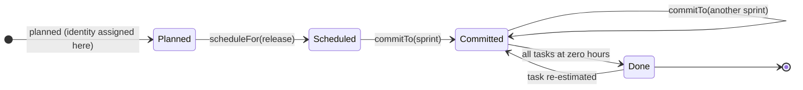

> [!TIP] The short version
> An **Entity** is a domain object defined by **who it is**, not by what its attributes currently say. Its attributes can all change and it stays the same object, because its identity doesn't change.
>
> Give it a stable identity as early as possible, compare it by that identity only, and change its state through methods named in the Ubiquitous Language, not through public setters. Model everything else as a Value Object.

## Problem context

Most enterprise codebases have classes called `Customer`, `Order` or `Product` that are really database rows with getters and setters. The rules that decide when a status may change, or which fields must move together, live in service classes around them. This is the **Anemic Domain Model**: you pay for an object model and get none of its protection, because any caller can put an object into a state the business would never allow.

The root cause is treating an Entity as a data container. Evans defines it differently:

> Some objects are not defined primarily by their attributes. They represent a thread of identity that runs through time and often across distinct representations.

A customer can change name, address, phone number and credit rating, and the business still needs to know it is the same customer. The same customer may also be a row in a relational table, a JSON document in a cache and an object in memory. What ties all of those together is the identity, not the data.

## What makes an object an Entity

Model a concept as an Entity when the business has to tell one instance apart from every other, even if they look identical, and has to follow it through changes over time. Vernon describes an Entity as a unique thing that can change continuously over a long period, so much that it may look nothing like it did when it was created, and still be the same thing.

| | Data container | Entity |
| --- | --- | --- |
| **Defined by** | Its columns and current values. | A thread of identity across its whole life. |
| **State changes** | Public setters: `setStatus()`, `setSprintId()`. | Domain operations: `commitTo(sprint)`, `deactivate()`. |
| **Business rules** | In service classes and controllers around it. | Inside the Entity, guarded by its Aggregate. |
| **Consistency** | Broken by a partial or out-of-order sequence of setter calls. | Checked in the constructor and in every operation. |
| **History** | A row is overwritten, and the reason is lost. | Each change is an explicit operation that can raise a Domain Event. |

## Entity or Value Object?

The first modelling question about any concept is which of the two it is:

- An **Entity** is defined by **identity**: *which one* is it? It changes over time, so it needs its identity tracked.
- A **Value Object** is defined by its **attributes**: *what, how much, what kind*? It is immutable, has no identity, and two with the same attributes are equal.

Khononov's advice is to lean towards Value Objects. Use an Entity only when the concept's state changes over time and the business must follow individual instances through those changes. Value Objects are smaller, easier to test, and can't be put into an invalid state by a later change.

### Identity depends on the context

Identity isn't a property of the real-world thing. It is a choice the model makes because the business in one Bounded Context needs it. Evans shows this with a street address, which is a different kind of object depending on who is modelling it:


- **Mail-order shipping:** the address is a Value Object. If two customers live in the same house, they hold two equal addresses, and nobody cares which copy is which.
- **Postal service:** the address is an Entity. Delivery routes are organised as regions, zones and blocks, and a change to a zone has to reach every address in it.
- **Electric utility:** the address is the place where lines and a meter are installed, so it is an Entity, or is attached to a `Dwelling` Entity. That service point outlives every person who lives there.

So "is it an Entity?" has no answer in general, only within a Bounded Context.

### Equality follows identity

Because an Entity is defined by its identity, two Entity objects are equal exactly when their identities are equal. No other attribute takes part:

```java
public class Customer {
    private final CustomerId id;
    private CustomerName name;           // can change; doesn't affect equality

    @Override
    public boolean equals(Object other) {
        if (this == other) return true;
        if (!(other instanceof Customer that)) return false;
        return id.equals(that.id);
    }

    @Override
    public int hashCode() {
        return id.hashCode();
    }
}
```

A Value Object does the opposite: it compares every attribute, because the attributes are all it has.

## Designing identity

Every Entity needs an identity that distinguishes it from all others, even when every descriptive attribute is the same. The identity type itself is best modelled as a Value Object (`CustomerId`, `BacklogItemId`), not a raw `String` or `long`, so that it can't be mixed up with another kind of identifier.

### Four ways to get an identity

Vernon describes four sources of identity:

| Source | How it works | Watch out for |
| --- | --- | --- |
| **The user** | The user types in a unique key, such as a tax number or an account code. | Typos and requests to change it. Keep the user's key as a searchable attribute, and use an internal identity that never changes, or make assignment a reviewed step. |
| **The application** | The application generates it, typically a UUID, before anything is saved. | Long, unreadable values. You can compose a readable one around a UUID fragment, such as `SCR-BI-2026-11-14-7E2A91C3` (context, type, date, random part). |
| **The persistence store** | A database sequence or auto-increment column. | Compact numbers, but an auto-increment value only exists after the `INSERT`. A sequence can be read before the insert, through the repository. |
| **Another Bounded Context** | An upstream context assigns it, for example an identity and access context issuing a `TenantId` or `UserId`. | The most complex option. The local context holds the foreign identity as an immutable Value Object and may have to follow changes in the other context through its Domain Events. |

Application-generated identities need no round trip to a database and are unique across distributed systems, which makes them a common default.

### Allocate identity early

The other decision is *when* the identity is assigned:

- **Early allocation:** the identity exists when the object is constructed, for example `new BacklogItem(repository.nextIdentity(), ...)`.
- **Late allocation:** the identity is assigned when the object is first saved.

Prefer early allocation. Late allocation breaks two things that come up quickly in a real model:


1. **Domain Events lose their subject.** An Entity that raises an event when it is created, or in any operation before its first save, publishes an event with a `null` identifier.
2. **Collections lose members.** With equality based on identity, several new Entities added to a `Set` before they are saved all compare equal (`null` equals `null`), and the set silently keeps only the first.

```java
public interface BacklogItemRepository {
    BacklogItemId nextIdentity();        // e.g. new BacklogItemId(UUID.randomUUID().toString())
    Optional<BacklogItem> itemOfId(BacklogItemId id);
    void save(BacklogItem item);
}
```

### Keep the database key out of the domain

Relational databases and ORMs such as Hibernate often want a numeric primary key for joins, indexes and foreign keys. That key is a technical concern, so separate the two:

- The **domain identity** (`ProductId`) is what client code sees and what business operations use.
- The **surrogate identity** (`long id`) exists only for the ORM and the database.

Vernon hides the surrogate key in a **Layer Supertype**, an abstract base class that domain classes extend, so it never appears in their public interface:

```java
public abstract class IdentifiedDomainObject implements Serializable {
    private long id = -1;                // surrogate key, used only by the ORM

    protected long id() { return id; }
    protected void setId(long id) { this.id = id; }
}
```

### Never change an identity

An Entity's identity must stay the same for its whole life. Other Aggregates, other contexts and published events refer to it, and changing it breaks every one of those references. Make the field `final` where you can. Where a framework needs a setter, guard it so the identity can be set only once:

```java
public class User extends IdentifiedDomainObject {
    private UserId userId;

    protected void setUserId(UserId userId) {
        if (userId == null)
            throw new IllegalArgumentException("The identity is required.");
        if (this.userId != null)
            throw new IllegalStateException("The identity is already assigned and can't change.");
        this.userId = userId;
    }
}
```

## Putting behaviour on the Entity

An Entity earns its place by doing things the business talks about. Its public methods should read like the Ubiquitous Language.

### Intention-revealing methods instead of setters

Take Vernon's Scrum example: a team commits a backlog item to a sprint. With setters, the client has to know every step and every rule:

```java
// ANTI-PATTERN: the client coordinates the state change
backlogItem.setSprintId(sprint.sprintId());
backlogItem.setStatus(BacklogItemStatus.COMMITTED);
```

Nothing checks that the item was scheduled for a release first. A caller that sets the sprint and forgets the status leaves the item inconsistent, and nobody else learns that anything happened. With a domain operation, the client states its intent and the Entity does the rest:

```java
backlogItem.commitTo(sprint);
```

```java
public class BacklogItem {
    private final BacklogItemId id;
    private SprintId sprintId;
    private BacklogItemStatus status;
    private final List<DomainEvent> events = new ArrayList<>();

    public void commitTo(Sprint sprint) {
        if (!isScheduledForRelease())
            throw new IllegalStateException("Must be scheduled for a release before it can be committed to a sprint.");

        if (isCommittedToSprint() && !sprint.sprintId().equals(sprintId))
            uncommitFromSprint();          // leaving the old sprint is part of the same operation

        this.status = BacklogItemStatus.COMMITTED;
        this.sprintId = sprint.sprintId();
        events.add(new BacklogItemCommitted(id, sprintId));
    }
}
```

The rule, the two fields that must change together and the event all live in one place, and there is no way to commit an item that skips them.

### Validate at three levels

Vernon separates validation by scope:

1. **Attributes.** Each attribute is set through a private, self-encapsulating setter that checks its own preconditions (not null, length, range) before it changes anything. This is Design by Contract applied to one field.
2. **The whole object.** Some rules involve several attributes, or only apply once an object is complete. Put those in a separate **Validator** class, which can collect every problem into a notification instead of failing on the first. That keeps rules that change often out of the Entity.
3. **Compositions of objects.** A rule that spans several Entities or Aggregates belongs to the Aggregate root or, if it crosses Aggregates, to a [Domain Service](/domain-driven-design/domain-service/).

### Roles without splitting the object

An Entity can play different roles in different use cases. A `Customer` may be something orders are added to in one flow and something that is made a preferred customer in another. You can express each role as a small interface, such as `AddsOrders` and `MakesPreferred`, so each client depends only on what it uses.

Let the Entity class implement those interfaces itself. If you instead hand each role to a separate delegate object, you risk **object schizophrenia**: the delegates hold part of the behaviour but not the Entity's identity, so it is no longer clear which object a call is really about.

## Entities live inside Aggregates

Khononov stresses that Entities aren't designed as free-standing objects. Each one belongs to an [Aggregate](/domain-driven-design/aggregate-pattern/), a consistency boundary around Entities and Value Objects that change together:

- The **Aggregate root** is an Entity with a **global identity**. It is the only object outside code may hold a reference to, and the only one a repository loads.
- **Internal Entities** have a **local identity**, unique only inside their Aggregate. Outside code reaches them through the root.

The Aggregate article covers the rest in detail: protect invariants inside the boundary, keep Aggregates small, refer to other Aggregates by identity only, and update them with eventual consistency.

## Managing the lifecycle

Three tactical patterns support an Entity from creation to retirement:

- A **Factory** builds an Entity with complex construction logic, and hands it over complete, consistent and with its identity assigned.
- A **Repository** stores and finds Aggregate roots by identity, and hides the storage technology.
- **Event sourcing**, if you use it, stores the Entity as the sequence of Domain Events that changed it. Loading it means replaying those events on a new instance to rebuild its current state.

The identity is what makes all three work: the factory assigns it, the repository looks it up, and the event stream is keyed by it.



Every state above belongs to the same `BacklogItem`. Its status, sprint and estimates change, and its identity doesn't.

## Design heuristics

1. **Start with a Value Object.** Make a concept an Entity only when the business needs to follow individual instances through changes.
2. **Keep the Entity lean.** Evans's advice is to keep its definition focused on identity and lifecycle. Move descriptive groups of attributes, such as an address or a money amount, into Value Objects.
3. **Model the identity as a Value Object** and compare Entities by it alone.
4. **Allocate identity at construction**, so events and collections work before the first save.
5. **Never change an identity.** Keep the database's surrogate key out of the domain interface.
6. **Replace setters with domain operations** that check their rules and change related fields together.
7. **Raise a Domain Event when something significant happens**, so other Aggregates and Bounded Contexts can react without being coupled to the Entity.
8. **Keep internal Entities few.** Each one makes the Aggregate bigger and its transactions more likely to collide.

## References

- Eric Evans, *Domain-Driven Design: Tackling Complexity in the Heart of Software* (Addison-Wesley, 2003) — Chapter 5, A Model Expressed in Software.
- Vaughn Vernon, *Implementing Domain-Driven Design* (Addison-Wesley, 2013) — Chapter 5, Entities.
- Vaughn Vernon, *Domain-Driven Design Distilled* (Addison-Wesley, 2016) — Chapter 5, Tactical Design with Aggregates.
- Vlad Khononov, *Learning Domain-Driven Design* (O'Reilly, 2021) — Chapter 6, Tackling Complex Business Logic.
- Martin Fowler, [Anemic Domain Model — martinfowler.com](https://martinfowler.com/bliki/AnemicDomainModel.html)
- Martin Fowler, [Layer Supertype — martinfowler.com](https://martinfowler.com/eaaCatalog/layerSupertype.html)
